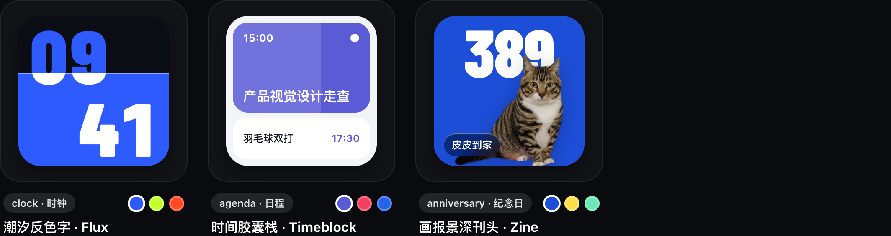
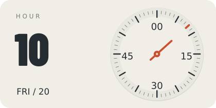

# Module Design

## 第一批入选模版：Wave 1 Curated（Flux / Timeblock / Zine）

首轮筛选保留的三款高对比图形与真实抠像模版：潮汐反色字（`clock`）、时间胶囊栈（`agenda`）、画报景深刊头（`anniversary`）。

[查看三款入选模版源码与预览说明](wave1-curated/README.md)

---

## 原生时钟专项：调校仪 · REGULATOR

原生调校仪式表盘：独立小时读窗、真实分钟刻度与指针、边缘日期。瓷白、奶油、钴蓝、墨黑四套配色，方形与横向分别设计。

[查看设计、作品包和集成说明](regulator/README.md)

**新版是新增原生模板，需要集成补丁并重建 App；未完成真机验收。** 已通过共享模型编译、全模板回归、11,520 场景的专项检查和实际尺寸视觉审查。详细限制和重建记录均保留。

## 历史归档

[暮线 · Meridian v1](meridian/DELIVERY.md) 保留源码、作品和验证记录。用户已否定其设计质量，作为历史归档保留，不再作为推荐方案。
