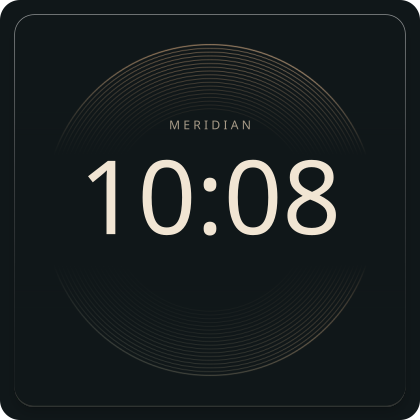
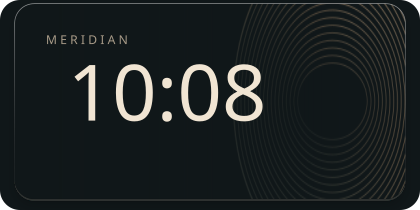

# 暮线 · MERIDIAN

原创离线时钟模板。深墨盘面、暖白读数、渐隐铜色轨道，让时间成为唯一视觉中心。




这是 `project_x` 支持的 **v2 静态源码/缓存 + 原生 clock capability** 作品包，不是网页截图成品，也不是新增内置 v3 `CardTemplate` ID。装饰源码在包内保留；时间不在图片里，由接收者宿主系统更新。无需改动 App 即可由当前读取器识别。

## 下载与使用

- [4×4 方形画布](meridian/dist/4x4.fridge)
- [2×2 小尺寸画布](meridian/dist/2x2.fridge)
- [2×4 横向画布](meridian/dist/2x4.fridge)
- [独立方形卡片](meridian/dist/square.card.fridge) · [独立横向卡片](meridian/dist/wide.card.fridge)

下载文件后使用冰箱贴的导入功能。画布与系统小组件须选择相同规格。每份只有一张卡片；可编辑整体布局、原生能力、署名字层。修改铜色装饰需要外部编辑源码后重新编译，App 不执行 HTML，也没有 HTML 源码编辑器。

## 可复现编译

使用 [project_x](https://github.com/alanmacX/project_x) 的固定提交 `1391bd6670090aa2559d017a86af6d3e8c9bb300`，建议与本仓库并列放置。

```sh
git clone https://github.com/alanmacX/project_x ../project_x
git -C ../project_x checkout 1391bd6670090aa2559d017a86af6d3e8c9bb300
npm ci --prefix ../project_x
npm ci
npm run build
npm run verify
cd ../project_x
NODE_OPTIONS="--require ../module_design/scripts/linux-typescript.cjs" npm run templates:check
```

若目录不同，设置 `PROJECT_X` 为编译器仓库绝对路径；`NODE_OPTIONS` 也使用正确路径。

构建调用原仓库 `fridge-html-card.cjs pack` 与 `fridge-compose.cjs`，没有重写协议或绕过生产读取器。当前沙箱不允许 Chromium 创建 socket，因此未完成 `fridge-static-render.cjs` 自动浏览器路径。装饰特意限定为纯 SVG：同一 SVG 嵌入保留的 HTML，并由 Sharp 以 2× 光栅化后送入原打包器；不存在另一套 CSS 布局仿制。原打包器的运行时派生字段被移除，几何控制在实际读取器限制内。

## 验证与限制

- 原仓库 `templates:check` 全通过，生产源码和生成物指纹一致。两项测试写死 macOS 路径，Linux shim 仅将该 TypeScript 依赖重定向到上游锁定依赖，未修改产品/测试断言。
- 五份 `.fridge` 通过原 `fridge-package-check.cjs`。方形 180/300/420px、横向 300/420px 通过共享布局输出检查，主时间完整。
- 共享 `previewer/renderer.js`、`capabilities.js` 和生产模型在 Node VM 中直接运行，napi canvas 测字，Sharp 光栅化。人工检查以上实际输出；横向经过一次构图迭代。
- 静态装饰无烘焙时间；00:00、11:11、23:59 输出随 tick 改变，源文件保持不变。无私人数据、远端素材或在线 provider。
- 未完成浏览器端导入、鸿蒙原生编译/模拟器/真实 Form 验收；系统字体与阴影在真机可能有差异。没有改动原生 App 源码，不能将本次结果描述为新增原生内置模板。
- 180px 中署名仅为装饰，不承载必要信息。轨道完全静态，不代表日照、进度或真实天文数据。

完整契约、几何、哈希和验证方法见 [QA](meridian/qa.json)，设计说明见 [制作记录](meridian/README.md)。截图使用固定示例时间 2026-11-20 10:08 UTC，仅供预览。
