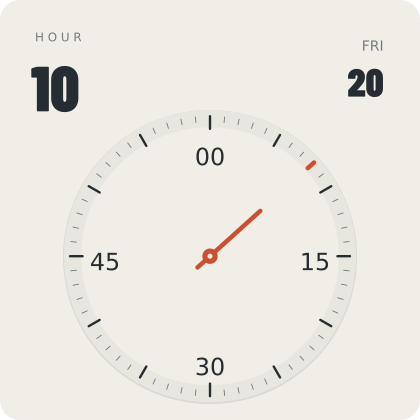
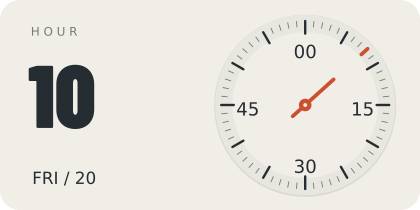
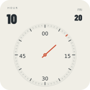

# 调校仪 · REGULATOR

一个原生时间仪表：小时独立显示，分钟交给真实刻度和指针，日期留在边缘。所有变化来自宿主的同一个 `tick`。不是在静态背景上叠一个通用数字时钟。





## 制作记录

- 稳定 ID / revision：`regulator` / 1；新增公开 `CardTemplate`，`clock` capability，一张 card。
- 主读数：24 小时制小时 + 分钟指针；辅助角色：同一系统时钟的星期/日期。没有多 provider、假天气、电量或私有数据。
- 概念：把制表调校仪中“小时与分钟分开阅读”的秩序转成桌面表盘。时间读取改变了构图，不再用装饰环填空。
- 参考：[Apple Watch 表盘功能](https://support.apple.com/en-ca/guide/watch/apde9218b440/watchos)、[Contour / Modular Duo 的边界与阅读层级](https://www.apple.com/newsroom/2021/09/apple-reveals-apple-watch-series-7-featuring-the-largest-most-advanced-display/)、[StandBy 远距离阅读](https://support.apple.com/en-gb/guide/iphone/iph878d77632/ios)。借鉴空间和信息层级，没有复制 Apple 表盘、字体或素材。
- 排版：方形 300×300，左上小时、右上日期、下方完整分钟盘；横向 300×150 左侧小时/日期、右侧分钟盘，独立排版。
- 材质：两层低对比的陶瓷盘面和轻微凹边，细刻度仅用于分钟；不画额外外壳、卡片网格或浮动按钮。
- 字体：主小时使用上游已授权的 Barlow Condensed Black（宿主 `TemplateDigits`）；分钟数字与文字用系统无衬线。保留上游字体授权，不拷贝 Apple 字体。
- 配色：瓷白 `#F0EEE6 / #262D32 / #CC4F32`；另有奶油、钴蓝、墨黑，沿用既有 palette 配置与撤销/保存机制。
- 细节：分钟指针有内指针和外圈同步标记，空出的文字环带避免整点、15、30、45 分遮字；60 枚真实刻度区分五分钟与单分钟。
- 定制：系统时间/日期、四套配色、填满画布、整体位置/尺寸/旋转。无照片或新 provider。
- 边界：全部 1440 个分钟位置 × 两种布局 × 四套配色；闰日、午夜、跨年；渲染不修改存储数据。
- 原生实现：`RegulatorScene.ets`、`CardTemplate.ets`、`TemplateScene.ets`、`TemplateFactory.ets`。不需要改 `CompositionCatalog`：这是一种时钟能力，不是多能力组合。
- 资产：无位图装饰，作品包 assets 为空。源代码生成刻度、底面和指针；字库由宿主已有资源提供。

## 使用前提

**本版本需要把 `integration.patch` 合入并重建 App。旧读取器不认识新 ID，不能直接导入。** 未冒用已有 ID 来伪造兼容性。

- [4×4 瓷白](dist/4x4-porcelain.fridge) · [2×2 瓷白](dist/2x2-porcelain.fridge) · [2×4 瓷白](dist/2x4-porcelain.fridge)
- [原生集成补丁](integration.patch) · [场景源码](src/RegulatorScene.ets)
- [共享模型编译产物（gzip）](compiled/shared-models.js.gz) · [模型契约](compiled/design-contract.json)

`dist/` 共 12 个 v3 包（三个尺寸 × 四套配色），均经新增模板后的生产读取器往返校验。

## 复现

准备与本仓库并列的 `project_x`，可定位提交 `1391bd6670090aa2559d017a86af6d3e8c9bb300`。在本仓库根目录：

```sh
npm ci
node regulator/build.cjs
```

也可设置 `PROJECT_X=/absolute/path/to/project_x`。构建脚本创建独立 detached worktree，检查并应用补丁、安装上游锁定依赖、执行真实 `previewer/build.cjs`、导出包、渲染、跑专门检查和 `templates:check`，不改动用户原编译器工作区。生成 worktree 路径在输出末尾。原生 App 最终编译仍使用项目的 DevEco/鸿蒙工具链。

## 验收证据与限制

- `templates:check`：40 单卡 + 5 组合，全部通过；只更新目录数量断言，不删除/放宽已有测试。
- [功能检查](qa/functional.json)：11,520 场景，文字框碰撞 0、指针遮字 0，12 个作品包往返通过。
- [从干净 worktree 重建记录](qa/rebuild.txt) · [上游完整检查](qa/templates-check.txt) · [包哈希](qa/packages.json)。
- 视觉审查实际共享 SVG 输出，覆盖 180/300/420px 和四套配色。两轮修正分别解决预览小字基线和分钟标记/读数避让；不是只检查 JSON。
- PNG 使用原版 `previewer/renderer.js` 和共享模型、真实授权字库。Sharp/librsvg 不完整支持浏览器的 `text-before-edge`，PNG 光栅化前仅转换基线；生产场景和浏览器适配器没有被改写。
- **未完成鸿蒙原生编译、模拟器导入、真实桌面 Form 或浏览器端像素对照。** 当前环境没有 DevEco SDK，Chromium socket 受限。共享模型编译通过不等于 App 原生验收。
- 全部截图固定 2026-11-20 10:08 UTC，用于复现；实际时刻由宿主更新。180px 中 HOUR/星期为次要信息，读时依赖小时数字、分钟刻度和指针。
- 这是待审美反馈、待真机验收的新设计，不宣称用户已经认可。
