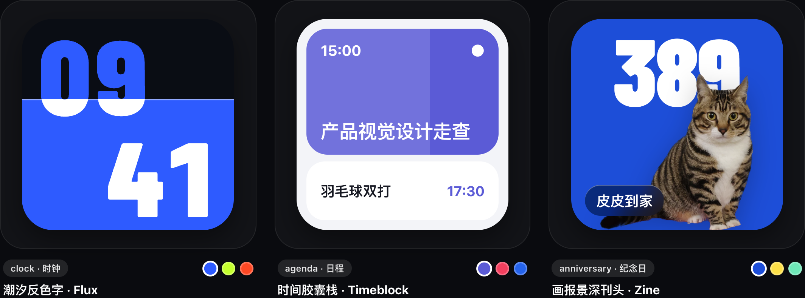
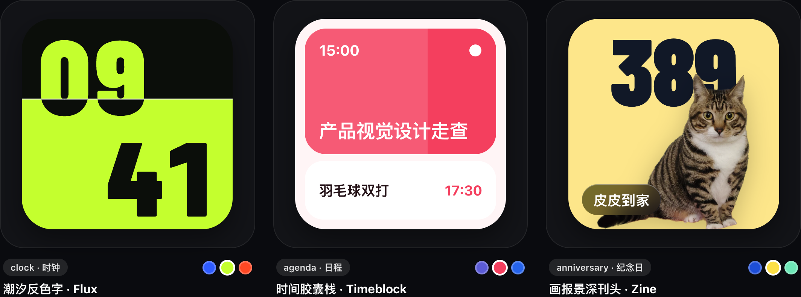
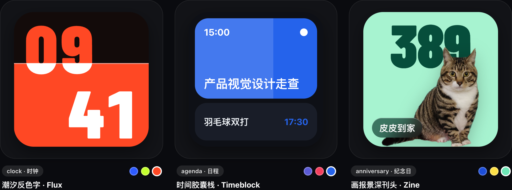
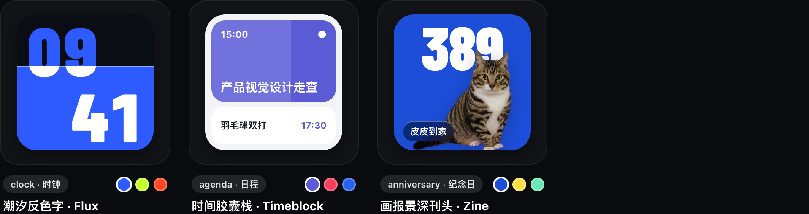

# 第一批入选模版 · Wave 1 Curated

保留首轮评审确认的 3 款设计（覆盖 3 种独立能力）：

1. **潮汐反色字 · Flux**（`clock` 时钟）：全画幅错落巨型数字与实时液面高度遮罩反色，无额外装饰字与伪刻度。
2. **时间胶囊栈 · Timeblock**（`agenda` 日程）：上下双层圆角时间块，当前日程内嵌横向时间流进度，底部独立承接下一场日程。
3. **画报景深刊头 · Zine**（`anniversary` 纪念日）：高饱和单色刊头大字叠加真实前景抠像遮挡，左下配高对比铭牌。






## 预览与复现

直接用浏览器打开 [index.html](index.html)，或运行自动化截图与零错误检查：

```sh
node wave1-curated/verify.cjs
```
