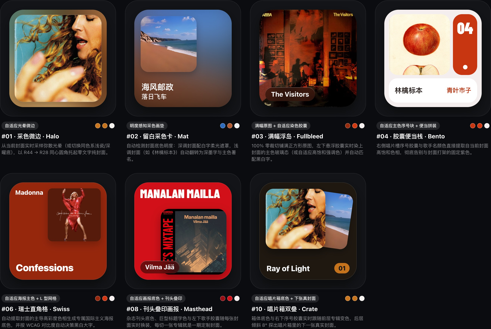
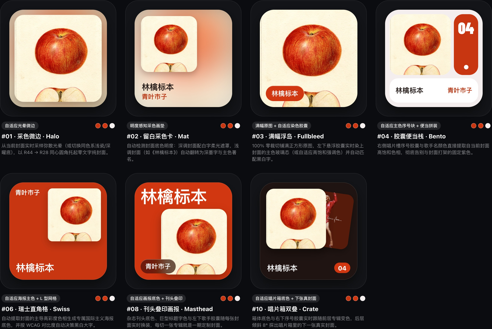
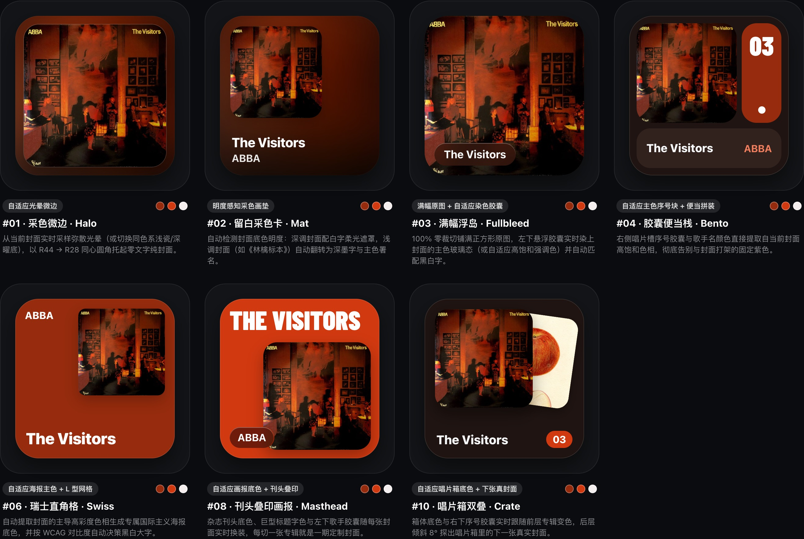
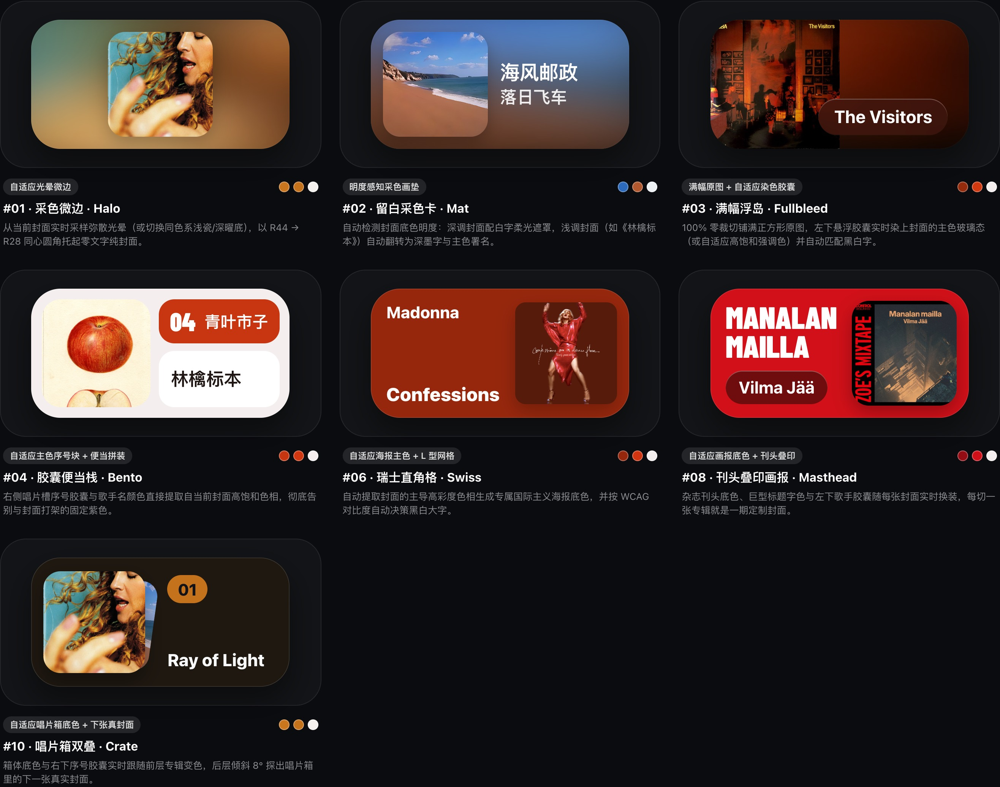
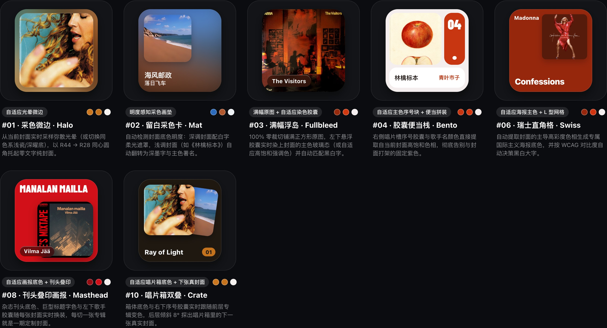

# 第二批入选模版 · Wave 2 Adaptive Albums（7 款全动态自适应采色专辑封面）

从专辑封面十款专项中保留选中的 7 款（原 `#01`、`#02`、`#03`、`#04`、`#06`、`#08`、`#10`），全面去除写死的固定配色，升级为**实时像素感知自适应配色引擎**（`adaptive-color.js`）：

- **自适应色相聚类**：实时读取任意 `1:1` 专辑封面像素，过滤低彩度纸底杂色，提取主导高彩度色相（Poster Field）、次级强调色相（Accent Pill）以及带同色相微调的浅瓷底（Adaptive Light）与深曜底（Adaptive Dark）。
- **明度与 WCAG 对比度自适应**：自动判断封面明暗（例如浅色纸底《林檎标本》与暗调油画《The Visitors》），动态切换柔光遮罩与黑白墨色，保证标题与歌手名对比度清晰。
- **双尺寸独立排版**：全部 7 款均提供 `2×2` 方形（`300×300`）与 `2×4` 横向宽幅（`300×150`）独立构图，封面始终严格保持 `1:1` 正方形。

## 入选 7 款列表

1. **`#01` 采色微边 · Halo**：零文字纯封面藏品，`R44 → R28` 同心圆角自适应采色微边。
2. **`#02` 留白采色卡 · Mat**：左上正方形封面 + 明度自适应采色画垫，深浅封面自动翻转字色。
3. **`#03` 满幅浮岛 · Fullbleed**：100% 满幅零裁切原封面 + 左下自适应染色玻璃标题胶囊。
4. **`#04` 胶囊便当栈 · Bento**：正方形封面 + 封面主色驱动的唱片槽序号柱 + 底部高对比曲目胶囊。
5. **`#06` 瑞士直角格 · Swiss**：自适应高彩度国际主义海报底色 + 右上微圆角封面与 L 型网格文字。
6. **`#08` 刊头叠印画报 · Masthead**：自适应画报底色与巨幅刊头大字 + 右下封面压叠与歌手胶囊。
7. **`#10` 唱片箱双叠 · Crate**：自适应深/浅唱片箱底色 + 后层倾斜 `8°` 探出下一张真实专辑封面。







## 交互预览与验证

用浏览器直接打开 [index.html](index.html)（支持点击卡片翻切专辑、切换智能主色/浅底/深底三种自适应模式、切换 `2×4` 宽幅，以及上传任意本地封面实时测试采色），或运行 252 状态自动化视觉检查：

```sh
node wave2-albums/verify.cjs
```
