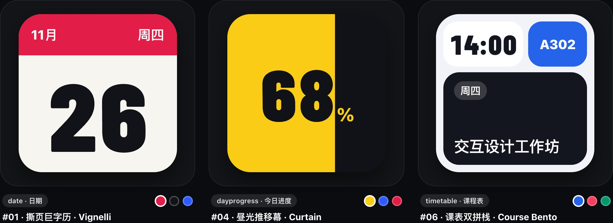
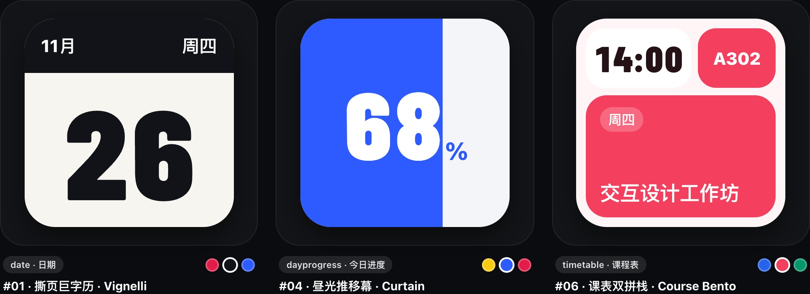
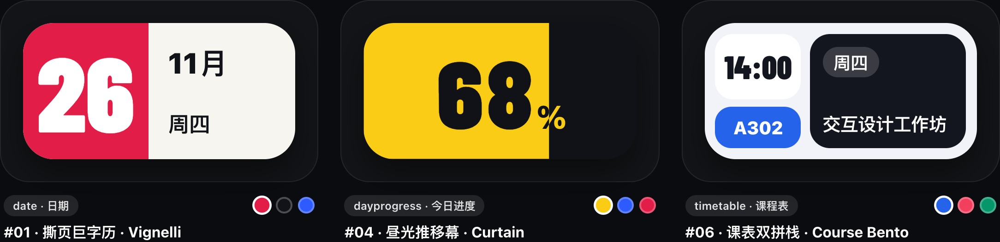
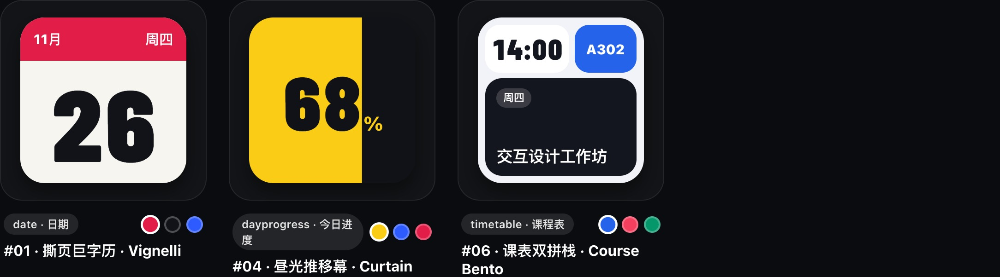

# 第三批入选模版 · Wave 3 Curated（Vignelli / Curtain / Course Bento）

第三批筛选保留的 3 款设计（覆盖 `date`、`dayprogress`、`timetable` 三种独立能力，同时提供 `2×2` 方形与 `2×4` 横向宽幅版式）：

1. **`#01` 撕页巨字历 · Vignelli**（`date` 日期）：高对比色带顶栏锚定月份与星期，下部 `182u` 巨幅日期数字撑满画幅。
2. **`#04` 昼光推移幕 · Curtain**（`dayprogress` 今日进度）：整张卡片即为线性进度幕布，`136u` 巨型百分比横跨色幕分界线实时反色。
3. **`#06` 课表双拼栈 · Course Bento**（`timetable` 课程表）：顶部时间块与高饱和教室块并排咬合，下部色块清晰托起周几与单行课程名。






## 交互预览与验证

用浏览器打开 [index.html](index.html)，或运行自动化截图验证：

```sh
node wave3-curated/verify.cjs
```
